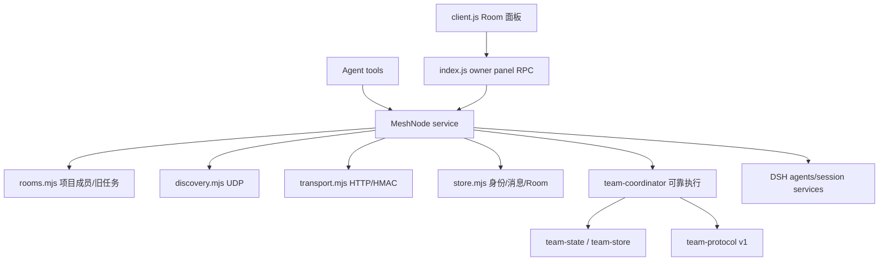
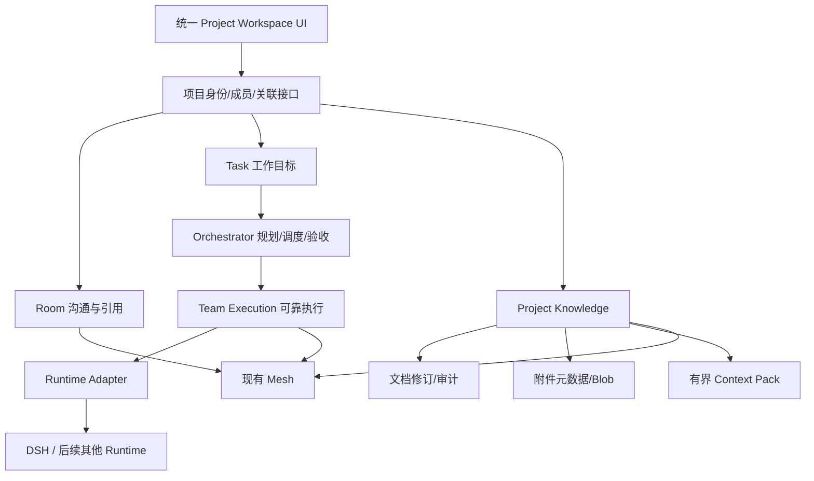

# Project Workspace 架构核对与建议（待负责人确认）

## 当前实际架构

已有 Mesh 协议 v2 与 Team 独立 v1。精确 Room 引用使用 `referencesVersion:1`、`/send-references`、扩展签名与能力探测；旧节点无法精确投递时明确失败。`lib/room-message.mjs` 校验引用。技能只是来源明确的引用，不安装、不自动执行。

## 目标架构

一个现有 Room ID 作为 Project Workspace 的项目身份，保留数据和加入机制；Room 是其沟通视图。新增 Overview/Documents/Activity 等是渐进视图，不要求立即实现全套 UI 或单一数据库。Task、Execution、Document、Attachment、Knowledge 有独立模型和生命周期，用 roomId/taskId/revisionId 等关联。

保留：Mesh 通信、Team 保守恢复与 uncertain 状态、显式授权、Room/Execution 分离、内容寻址附件、基于版本的文档合并与追加审计、冲突确认权限。

需调整或补充：

- `MeshNode` 是现有集成边界，先以小型适配接口隔离 DSH runtime，避免现在拆成大量服务。未来统一 capability 描述需单独设计；当前 Agent 目录不等于标准跨 Runtime 协议。
- Team Task 与旧 Room task 是两套现存模型，先增加关联映射设计，不共享或合并状态机。
- 技能引用现有 sourceNodeId/name 不含版本/环境；下一批保持现有协议，版本化能力及远端技能目录需另行批准。选择引用不自动执行，Agent 只能自主使用本机实际可用技能。
- 文档采用单一排序者与事务审计的设计尚未实现。离线 proposal、generation 恢复、维护者授权及备份策略必须在编码前明确；hash chain 仅能检测篡改，不保证共享密钥成员不可伪造。
- Blob 双持久 holder 的设计保留为候选；同机 Leader 只有一份物理副本，不能宣称双设备容灾。GC 必须尊重已提交消息/文档引用。

## 差距分析

已完成代码：节点发现、Room 创建/发现/加入、身份名称、机器消歧、精确 mentions、长 Session 唯一映射、skillRefs 协议；Team ACK/lease/outbox/reconcile 与持久化及异常测试。

进行中但未落地：技能选择器任务已派发，实施者用量限制退出；核对时工作区干净，无 roomSkills/skill picker 代码，不能按“已开始”计为实现完成。

未开始：独立 Blob 附件、共享文档业务代码、Project Context Pack、自动 Orchestrator、通用 Runtime adapter。

待验收：M1 真实 A/B/C 设备与真实模型执行。`scripts/team-smoke.mjs` 明确 stub followup，使用 localhost，两 Worker 同节点；不能替代三设备验收。历史用户反馈只能证明发现项目及部分 UI 操作，不能证明 Team M1 全链路。

文档差异：受控实施计划复选框仍未同步，忽略台账记录 Task1–3 已通过、Task4未完成。ROADMAP 与正式交接稿作为当前统一状态；旧日志保留，不覆盖历史。
