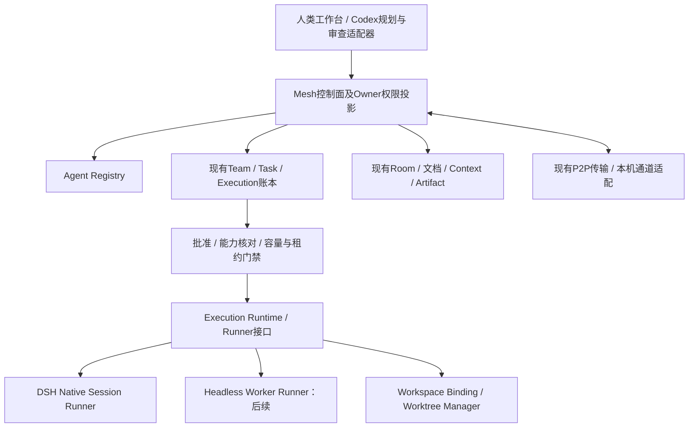

# dsh-lan-mesh 架构合并稿 V0.1（待复审）

日期：2026-11-17。用途：将跨工作区方案与现有实现合并，供第二轮架构评审；不是终版或M6实施授权。本轮只新增本文，不覆盖既有设计或产品代码。

## 1. 基线及真实状态

已提交HEAD：384f9d6，代码基线7eff5a7/v0.4.20。当前工作树另有DSH正在进行的service、测试及UX取证修改，未经本轮验收；不能把它们算进已提交基线或清理。原room-collaboration中的0.4.5/G2成果引用和暂停M6仍独立保护。

现有可复用：P2P节点发现与认证；Room及精确成员身份；附件与共享文档修订；Context Pack；Team任务/Execution账本、ACK、租约、幂等、uncertain及结果审查相关状态；UX工作台。注意这些是代码能力，不等于真实多机/模型门槛全部通过。Agent目录当前主要围绕Session，Workspace主要依赖cwd；不能据此宣称已有持久Agent Registry或Workspace Manager。

UX-6真实宿主/物理双机验收尚需按最新证据逐项核实。G2 executionId+resultHash引用未合入本分支，不认定完成。Team人类Owner只读投影缺明确接口和权限范围。v0.4.20自动已读队列的并发一致性发现需由DSH继续复现处理，不与本架构研究混成同一批开发。

## 2. 目标与冻结约束

支持同机不同Workspace、同机不同Host实例、跨电脑三种拓扑。选择混合模式：长期Agent逻辑身份，按任务创建独立Worker实例。Codex可规划/审查，DSH可执行，但两者均经Mesh控制面。

保留五项ADR：P2P；每Team固定Leader；Worker独立目录/Worktree；执行前人工批准且绑定版本/哈希；Leader故障暂停并人工接管；Review后人工确认合并（其中执行隔离与批准分别是原五项中的第二、第三项）。不引入自动选主、第二套任务账本、隐式执行重试或自动合并。

## 3. 统一领域模型

| 对象 | 身份与权威 | 职责 |
|---|---|---|
| Node | nodeId；本节点管理并认证 | 设备/Host实例边界，不能直接等于物理电脑 |
| Workspace | workspaceId；归属节点 | 本地路径、逻辑repoId绑定、权限根、运行环境；远端路径不可直接在本机打开 |
| AgentDefinition | agentId；唯一管理节点+revision | 长期角色/能力/模型配置/Skill引用；不代表进程在线或执行许可 |
| AgentBinding | agentId+nodeId+workspaceId | 将逻辑Agent绑定到可执行环境；跨设备绑定不等于转移身份权威 |
| Session | 原DSH Session身份+节点 | 对话、上下文及可恢复宿主会话；不能当Agent长期ID |
| Team | teamId；固定Leader | 成员引用、任务组织与执行协调，复用已有Team状态机 |
| Room | roomId；沿用现有权威规则 | 讨论、成员、文件与上下文；Room Leader不自动取得其他Team或文档权威 |
| Plan | planId+revision+hash | 待批准的任务与依赖、范围和执行约束；不可变批准快照 |
| Task | taskId+teamId | 业务目标/验收条件，可经历多次Execution |
| Execution | executionId+attempt+generation | 一次实际执行；固定Agent配置、Workspace、Runner、输入版本与授权快照 |
| WorkerInstance | workerInstanceId；执行节点 | 一次Runner运行资源，绑定Execution；不是另一套任务状态机 |
| Artifact/Review | 沿用并扩展现有固定引用 | 内容哈希、来源Execution与证据；提交、审查、验收、人工合并分开 |

避免以名字、绝对路径、Session ID当作跨设备逻辑身份。凭据不进入Agent公共目录，只保存本地凭据句柄和可用性观测。

## 4. 模块与边界

Registry不调度，Workspace不批准任务，Runner不决定重新派单，UI不自行修改执行权威状态。本机调用也必须经过相同业务门禁；只优化传输，不增加旁路执行。

## 5. 待批准ADR建议

A. Agent身份：第一阶段由唯一管理节点持有，其他节点只持引用/投影；不自动跨设备迁移。以后显式迁移需权威代次、旧绑定撤销和审计，必须证明不会双活。

B. 源码准备：节点预先准备可信仓库，Workspace绑定逻辑repoId、本地路径和许可；执行批准固定baseCommit，每次使用独立Worktree。Mesh不做任意目录同步。跨系统产物用校验过的补丁/提交/Artifact交付。

C. Team/Room：第一阶段每Team关联一个主Room；一个Room可关联多个Team，但各自Leader/权限分离。暂不引入任意多对多写权限；跨Room采用显式引用。需核实当前Team约束后给出迁移策略。

D. Runner：先适配现有DSH Session路径，再加入Headless；先统一接口，不要求首期双实现同时上线。长期对话可恢复Session，代码任务优先独立执行环境；Runner能力必须实际探测。

E. 执行快照：记录Agent配置revision/hash、模型标识、Skill/Rule固定版本、Workspace/baseCommit、Context引用、Runner版本和审批范围。配置改变不追溯改变已获批Execution。

F. 主动领取：Worker提交领取申请，由Leader按任务版本、容量、资格及现有账本原子仲裁；不能由本机先执行再补账。任务转交必须结束/核对旧Execution，不能只改assignee。

以上均为建议，未将尚待评审选项视为已批准。

## 6. 接口草案及故障语义

Registry：register/update/resolve/list；更新按revision防并发覆盖，公共目录与本地敏感配置分离。
Workspace：resolveBinding/prepareExecution/releaseExecution；调用必须带Execution与已批准范围，不接收任意远端绝对路径执行。
Runner：probe/start/cancel/inspect/collect；start绑定executionId与幂等键；重复请求不能多创建Worker。inspect返回观测及时间，不自行写task accepted。
Orchestrator：复用现有dispatch/report/reconcile，领取是同一权威状态机的扩展。Execution状态仅由原账本规则推进，Worker进程状态是观测数据。

取消请求不等于进程已停止；失联/租约到期进入核对流程，不自动启动替代执行；旧Worker事件必须按generation/attempt拒绝过期写入。Headless启动后ACK丢失需要查询已有实例，不能无条件重启。重启恢复后先核对本地执行与账本，再释放容量/Worktree。Worktree有未审查成果时不能自动删除。

安全：人类Owner只读投影必须单独定义成员范围及脱敏；不能伪造Agent身份调用Team工具。能力声明不是授权，Peer可见不是可派发；工作区路径、凭据和原始执行日志按最小范围暴露。

## 7. 兼容与路线

阶段0：完成v0.4.20后续一致性修复及当前UX验收，核对SDK、真实M1/多机门槛；不把历史测试数量当新证据。
阶段1：盘点并独立验收G2固定成果引用，梳理Agent/Workspace字段和旧nodeId/sessionId映射；不能直接搬入未提交工作。
阶段2：冻结Registry/Binding/Runner契约，实现最小Registry与现有Session Runner适配；旧会话继续可用，未知能力不展示为可执行。
阶段3：证明现有执行路径无回归后，实现独立Worker/Worktree生命周期、启动幂等和恢复，完成跨系统样例。
阶段4：经明确恢复授权后推进M6 Plan批准、DAG、容量/能力门禁、Review及人工合并；复用既有账本和冻结ADR。

采用可选字段/能力协商和渐进适配；旧节点无新能力就明确不可用，不伪装执行成功；禁止双写两套权威账本。新增存储schema要有升级、失败恢复和旧数据读取方案。

## 8. 验收门槛

- Agent改名、Session重建后逻辑身份仍稳定；不同节点同名不合并。
- 同机与跨机相同任务获得相同准入/权限结论，无本地旁路。
- 同一Execution重复start、ACK丢失、Host重启最多产生一个可确认执行；不确定时不自动重复。
- 相同task两次attempt、旧generation事件、主动领取冲突均可审计且隔离。
- Windows/macOS路径不同但repoId/baseCommit可核对；Worktree不覆盖用户未提交文件。
- 配置变更不改变旧Execution快照，成果引用固定executionId+hash。
- 取消、进程退出、结果提交、Review、验收、合并分别有证据。
- Leader离线暂停，接管显式授权；凭据/私有路径不广播。
- 未执行的物理多机、模型或故障注入场景保持NOT RUN。

## 9. 转回ChatGPT的第二轮评审范围

请只评审这份合并稿，不再扩展功能清单，不修改代码。逐项给出同意/需修改/待决定及理由：
1. 与五项冻结ADR、当前Team账本是否冲突？哪些建议其实已有实现？
2. 唯一Agent权威节点及未来迁移如何防双活？Agent与Binding的边界是否过重？
3. repoId/baseCommit/Worktree方案能否满足跨系统协作？
4. Team主Room关联是否兼容现状，是否隐藏权限扩大？
5. Runner幂等、取消与重启恢复是否能落到现有Execution机制，而非第二账本？
6. G2、UX、Registry、Worker和M6顺序是否存在循环依赖？
7. 首期最小交付是否还能收紧？列最多5个阻塞决策，不把建议变成授权。

开源来源说明：上游聊天提到的项目只是研究线索，本轮没有逐仓核验其最新源码、许可证或兼容性，因此不将它们的能力描述作为已验证实现依据。真正复用前须固定commit、核对许可证和SDK边界。
